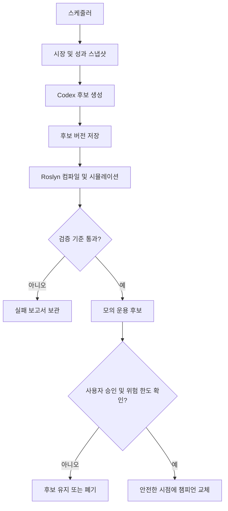

# DumbTrader Codex 전략 자동 개선 개발 계획

- 작성일: 2026-11-17
- 문서 상태: 개발 제안서
- 대상 저장소: DumbTrader WPF / .NET 9
- 우선 적용 시장: 해외선물 시뮬레이션 및 모의 운용
- 구현 및 검증 방법은 [전략 후보 생성 및 모의 운용](DumbTrader_StrategyEvolutionOperation.md)에 기록한다.

## 1. 목표

DumbTrader가 일정 주기로 거래 성과와 시장 데이터를 요약하고, Codex를 이용해 C# 전략 후보를 생성·수정한다. 후보는 Roslyn 컴파일과 과거 데이터 검증을 거친 뒤 모의 운용에 투입한다. 검증 기준을 통과한 후보만 사용자가 승인해 실시간 전략으로 승격한다.

이 계획의 첫 목표는 **전략 후보 생성과 검증을 자동화하는 것**이다. AI가 자체 판단만으로 실계좌 전략을 바로 바꾸거나 주문 권한을 갖는 동작은 초기 범위에서 제외한다.

## 2. 현재 코드 기준선

2026-11-17 현재 소스에서 확인한 구조는 다음과 같다.

| 영역 | 현재 구현 | 계획상 의미 |
|---|---|---|
| Roslyn | `Services/RoslynScriptRunner.cs`에서 C# 스크립트를 컴파일하고 실행한다. 스크립트 파일 실행과 실행 시간 제한이 있다. | 후보 코드 컴파일·시뮬레이션에 재사용할 수 있다. 실행 시간 제한은 프로세스 격리를 대신하지 않는다. |
| 해외선물 실시간 전략 | `Services/OFutureStrategyService.cs`가 선택 계약의 실시간 데이터를 스크립트에 전달해 `BUY`·`SELL`·`HOLD` 신호를 계산한다. | 신호 산출 경로를 전략 버전과 연결할 수 있다. 현재 대시보드에서는 선택된 계약에 대해서만 실행한다. |
| 해외선물 주문 | 해외선물 전략 서비스는 신호를 표시하지만 주문을 제출하지 않는다. `OFutureOrderService`는 별도 서비스다. | 기존 실시간 신호를 실제 주문으로 승격했다고 간주하면 안 된다. 주문 연계는 독립 단계로 둔다. |
| 해외선물 시뮬레이션 | `Services/OFutureSimulationService.cs`가 저장된 일봉·1분봉·10분봉을 순회하고 손익, 수익률, 승률, 거래 수를 산출한다. 시그널은 다음 바 시가에 적용한다. | Codex 후보 전략을 평가할 출발점이 있다. 수수료·슬리피지와 체결 가정은 검증·보완해야 한다. |
| 주식 전략 | `Services/StrategyService.cs`가 메인 전략과 매수·매도 스크립트를 실행한다. `StrategyGlobals`에 주식 데이터 서비스 등이 전달된다. | 자동 후보 생성에 앞서 주식 전략과 실제 주문 서비스 간 연결을 확인해야 한다. 현재 전역 객체에는 `IStockOrderService`가 직접 제공되지 않는다. |
| 전략 이력 및 승격 | 후보/챔피언 버전, 평가 보고서, 자동 승격·롤백 구조는 확인되지 않는다. | 별도 저장소 모델과 운용 상태 흐름이 필요하다. |
| 외부 시황 정보 | 저장된 가격 데이터와 실시간 체결은 확인되지만, 뉴스·경제지표를 후보 생성 입력으로 만드는 경로는 확인되지 않는다. | Codex가 사용할 시장 정보는 명시적으로 수집·요약해 입력해야 한다. |

해외선물 전략 실행 경로는 가격 데이터를 읽어 Roslyn 스크립트를 실행하고 신호를 표시하는 구조다. 자동 최적화는 현재 코드의 작은 옵션 추가로 끝나는 일이 아니라, **후보 관리·평가·승격·감사 이력**을 추가하는 기능이다.

## 3. 설계 원칙

1. **Codex는 후보를 제안하고, DumbTrader가 평가한다.** Codex의 자체 설명이나 단일 백테스트 결과만으로 후보를 통과시키지 않는다.
2. **후보와 운용 전략을 분리한다.** 생성 중인 파일을 실시간 실행 경로에서 읽지 않는다.
3. **전략은 신호만 반환한다.** 포지션 한도, 주문 수량, 일일 손실 한도, 주문 제출은 전략 코드 바깥의 호스트가 통제한다.
4. **평가 데이터와 기간을 분리한다.** 같은 기간의 결과를 반복해서 보고 전략을 고르면 과최적화가 생길 수 있으므로 시간 순서대로 학습·검증·최종 평가 구간을 둔다.
5. **재현 가능해야 한다.** 전략 코드, 입력 데이터 범위, 비용 가정, 파라미터, 모델 프롬프트, 평가 결과를 버전별로 보존한다.
6. **실전 전환은 포지션 상태를 고려한다.** 미체결 주문이나 보유 포지션이 있는 상태에서 전략을 교체하지 않거나, 기존 포지션을 관리할 명시적 규칙을 적용한다.
7. **실행 실패 시 기존 운용 버전을 유지한다.** 컴파일·시뮬레이션·모의 운용의 어느 단계에서든 실패하면 후보만 폐기하고 챔피언은 바꾸지 않는다.

## 4. 목표 아키텍처

### 4.1 권장 컴포넌트

- `StrategyEvolutionCoordinator`: 주기 작업의 전체 흐름과 중복 실행 방지.
- `MarketSnapshotBuilder`: 시세·봉·변동성·거래량·포지션·최근 실적을 크기 제한된 입력으로 구성.
- `ICodexStrategyGenerator`: 후보 생성 인터페이스. 첫 MVP는 `codex exec`를 별도 프로세스로 실행하고, 필요해지면 SDK 또는 app-server 연결을 검토한다.
- `StrategyCandidateRepository`: 후보 코드, 체크섬, 상태, 프롬프트, 데이터 구간 및 보고서를 저장.
- `StrategyCompiler`: 실행과 분리해 후보를 컴파일하고 진단 결과를 반환.
- `StrategyEvaluationService`: 워크포워드 시뮬레이션 및 비용·위험 지표 계산.
- `PaperTradingService`: 후보 버전을 실시간 데이터에 적용하되 주문은 내지 않고 가상 체결과 성과만 기록.
- `StrategyPromotionService`: 승인된 버전을 안전한 전환 지점에서 활성화하고 이전 버전을 롤백 가능하게 유지.
- `RiskGate`: 수량, 포지션, 일일 손실, 최대 낙폭, 거래 가능 시간 등 실행 직전의 제한을 강제.

### 4.2 버전 저장 모델

초기에는 SQLite의 별도 테이블을 사용하거나 기존 EF Core 패턴에 맞춰 테이블을 추가한다. 전략 소스만 파일명으로 관리하지 말고, 내용 해시와 실행 설정을 함께 보존한다.

`StrategyCandidate` 권장 필드:

- `CandidateId`, `Market`, `Symbol`, `CreatedAtUtc`
- `ParentCandidateId`, `Source` (수동 / Codex)
- `CodePath`, `CodeHash`, `PromptVersion`, `ModelName`
- `Status` (Generated, Compiled, Evaluated, Paper, Approved, Rejected, Active, RolledBack)
- `EvaluationWindow`, `CostModelVersion`, `EvaluationMetricsJson`
- `FailureReason`, `ApprovedAtUtc`, `ActivatedAtUtc`

전략별 현재 챔피언은 별도 활성 포인터로 관리한다. 후보 코드를 기존 `strategy/ofuture/main`의 파일에 바로 덮어쓰지 않는다.

## 5. 한 번의 자동 개선 주기

1. **실행 조건 확인**: 시장 세션, 앱 연결, 작업 시간, 이전 주기 실행 여부를 확인한다. 한 번에 하나의 후보 생성 작업만 허용한다.
2. **입력 스냅샷 생성**: 최근 OHLCV와 기술 지표, 변동성·거래량 요약, 현재 전략의 성과, 포지션 상태를 생성 시점과 함께 고정한다. 브로커 비밀번호, 계정 토큰, 불필요한 개인 데이터를 Codex 입력에 포함하지 않는다.
3. **Codex 작업**: 현재 챔피언 코드, 전략 API 규약, 허용된 변경 범위, 평가 기준 및 입력 스냅샷을 전달한다. 출력은 지정된 후보 디렉터리 안의 C# 소스와 변경 설명으로 제한한다.
4. **정적 사전 검사**: 허용되지 않은 파일 접근·외부 네트워크·프로세스 실행·주문 호출이 있는지 검사한다. 스크립트에서 직접 주문 서비스를 호출하는 API는 제공하지 않는다.
5. **Roslyn 컴파일**: 컴파일 오류가 있으면 후보를 거절하고 진단을 저장한다. 실행 시간·메모리 한도는 별도 프로세스 격리와 함께 검토한다.
6. **과거 시뮬레이션**: 거래 비용, 슬리피지, 체결 가격 가정을 적용해 학습 구간과 순차 검증 구간에서 평가한다. 최종 미사용 구간은 후보 탐색 중에 열람하지 않는다.
7. **후보 비교**: 챔피언 대비 순수익뿐 아니라 최대 낙폭, 위험 조정 수익, 거래 횟수, 거래당 손익, 시장 국면별 편차를 비교한다. 표본 거래 수가 부족하면 통과시키지 않는다.
8. **모의 운용**: 통과 후보를 실시간 데이터에 병렬 적용하되 주문은 전송하지 않는다. 챔피언과 후보의 신호·가상 체결 결과를 같은 기간 비교한다.
9. **승격**: 통과 보고서와 차이를 사용자에게 보여준다. 승인 전에는 실시간 챔피언을 교체하지 않는다. 승인 후에도 포지션·미체결 주문이 없고 RiskGate가 허용할 때만 활성 버전을 바꾼다.
10. **모니터링 및 롤백**: 성능 한도 위반, 데이터 지연, 연속 오류, 잘못된 신호가 발생하면 신규 주문을 차단하고 이전 버전으로 복구한다. 전환 이력과 이유를 남긴다.

## 6. 단계별 개발 일정 및 완료 조건

각 단계는 실제 일정 추정 전의 작업 순서이며, 완료 기준을 충족한 뒤 다음 단계로 진행한다.

### 단계 0 — 주문 경로와 현 시뮬레이터 확인

**작업**

- 주식 메인·매수·매도 스크립트가 실제 주문 서비스를 호출하는지 확인하고, 모의/실계좌 구분을 명확히 한다.
- 해외선물 신호 서비스와 `OFutureOrderService` 사이의 현재 연결 여부를 문서화한다.
- 해외선물 백테스트의 비용, 체결가, 계약 승수, 데이터 중복·누락, 세션 처리 가정을 검토한다.
- `RoslynScriptRunner`와 스크립트 전역 객체가 제공하는 권한을 목록화한다.

**완료 조건**

- 주식 및 해외선물의 “신호 산출 → 주문 요청 → 체결 확인” 흐름도가 작성되어 있다.
- 모의 운용과 실주문을 구분하는 단일 설정/게이트의 위치가 정해져 있다.
- 시뮬레이션이 계산하지 않는 비용과 제약이 목록화되어 있다.

### 단계 1 — 전략 계약과 평가 재현성

**작업**

- 시장별 스크립트 입력·출력 규약을 명확히 한다. 기본 출력은 `Action`, `QuantityHint`, `Reason`, `StrategyState` 형태의 신호 DTO로 정리한다. 주문 제출 객체는 넣지 않는다.
- 평가 데이터와 데이터 구간을 고정하고, 비용 모델과 포지션 규칙을 설정으로 분리한다.
- 기존 해외선물 시뮬레이터에 거래 비용·슬리피지 파라미터, 최대 낙폭 및 리스크 지표를 추가한다.
- 같은 코드·데이터·설정으로 반복 실행했을 때 같은 결과가 나오는지 검증할 테스트를 계획·작성한다.

**완료 조건**

- 전략 버전·평가 데이터·비용 모델만으로 결과를 재현할 수 있다.
- 기존 결과와 비용 반영 결과가 구분되어 표시된다.
- 전략 코드가 신호만 반환하고 실행 측에서 포지션과 주문 한도를 강제한다.

### 단계 2 — 후보 버전과 결과 기록

**작업**

- `StrategyCandidate` 저장소와 상태 전이를 구현한다.
- 현재 활성 챔피언, 새 후보, 이전 버전, 평가 보고서를 조회하는 서비스 API를 추가한다.
- 후보를 독립 파일/작업 폴더에 기록하고, 원자적 저장 후 체크섬을 만든다.
- 화면에 후보 생성 시각, 상태, 컴파일 결과, 지표 비교, 실패 이유를 표시한다.

**완료 조건**

- 후보를 저장·비교·거절·승인·롤백해도 기존 챔피언 파일이 변경되지 않는다.
- 모든 상태 전환과 사용자 승인이 감사 로그에 남는다.

### 단계 3 — Codex 작업 실행기

**작업**

- `ICodexStrategyGenerator` 경계와 실행 설정을 추가한다.
- MVP는 DumbTrader가 정해진 작업 시점에 `codex exec`를 별도 프로세스로 호출하는 방식으로 구현한다. CLI 경로·작업 디렉터리·타임아웃·취소·로그 수집을 설정 가능하게 한다.
- 인자 배열 API를 사용하고 사용자 입력을 셸 명령 문자열로 조합하지 않는다.
- Codex가 저장소 전체를 임의 변경하지 않고 후보 소스와 설명만 지정 디렉터리에 쓰도록 작업 범위를 제한한다.
- 모델/인증 오류, 프로세스 종료 코드, 시간 초과, 빈 출력, 잘못된 파일 출력을 정상적으로 처리한다.

**완료 조건**

- 네트워크/인증 실패나 Codex 실행 실패가 발생해도 챔피언 전략과 매매 경로에 영향이 없다.
- 후보와 생성에 사용된 입력·프롬프트·실행 로그를 연결해 볼 수 있다.
- 반복 실행 방지, 중단 및 재시도 정책이 동작한다.

Codex 통합은 한 번의 제한된 작업에는 `codex exec`를 우선 사용하고, 대화 재개·이벤트 스트림·승인 처리가 필요한 제품 내 통합으로 확장할 때 SDK나 app-server를 검토한다. OpenAI도 이 구분을 안내한다. [Codex as a platform](https://developers.openai.com/blog/codex-as-a-platform).

### 단계 4 — 컴파일과 워크포워드 평가

**작업**

- 컴파일 진단을 실행과 분리해 후보 상태로 저장한다.
- 시간 순서 기반의 학습·검증·최종 평가 구간과 롤링 워크포워드 평가를 구현한다.
- 거래 비용, 슬리피지, 데이터 부족, 표본 거래 수, 최대 낙폭에 대한 게이트를 둔다.
- 결과 지표와 함께 평가 기간·데이터 수·매매 횟수·가정을 화면과 보고서에 표시한다.
- Codex에 후보를 반복 요청해 동일 평가 구간에 과적합하는 문제를 줄이도록 최종 평가 구간을 분리한다.

**완료 조건**

- 후보가 컴파일 실패, 데이터 부족, 비용 반영 후 기준 미달, 낙폭 초과 중 하나라도 해당하면 자동 거절된다.
- 챔피언과 후보의 차이를 같은 데이터·비용 설정으로 비교할 수 있다.
- 기준값은 설정으로 관리되고 기본값의 근거와 변경 이력이 남는다.

### 단계 5 — 실시간 모의 운용

**작업**

- 후보가 실시간 시세를 받되 주문은 생성하지 않는 `PaperTradingService`를 추가한다.
- 후보별 상태(Context)를 버전과 심볼에 묶어 저장한다. 후보 전환 시 상태를 무조건 재사용하지 않는다.
- 실시간 신호, 가상 체결, 챔피언과의 편차, 입력 데이터 지연을 기록한다.
- UI에서 모의 운용 시작·중단 및 후보 상태를 확인하게 한다.

**완료 조건**

- 후보 코드가 실제 주문 API를 호출할 수 없다.
- 데이터 지연·실행 오류·비정상 신호를 탐지하고 후보를 자동 중단할 수 있다.
- 최소 모의 운용 기간과 표본 거래 수 기준을 설정할 수 있다.

### 단계 6 — 승인 기반 활성화와 복구

**작업**

- 사용자에게 후보 코드 변경 요약, 평가 보고서, 비용 포함 성과, 손실 구간 및 위험 지표를 보여주고 명시적 승인 버튼을 제공한다.
- 포지션이 FLAT이고 미체결 주문이 없는 시점에만 새 버전을 활성화한다. 그 외에는 보류한다.
- 전략 실행 시점마다 활성 버전 ID를 고정해 주문/신호와 코드 버전을 연결한다.
- 킬 스위치, 최대 포지션, 최대 계약 수량, 일일 손실 한도, 연속 오류 제한, 이전 버전 롤백을 추가한다.

**완료 조건**

- 사용자 승인 없이 실시간 챔피언 버전이 바뀌지 않는다.
- 교체와 롤백이 재시작 후에도 기록에 남고 재현 가능하다.
- 위험 한도 초과 시 전략 신호가 주문으로 이어지지 않는다.

### 단계 7 — 주식 지원 확대

**작업**

- 주식 메인·매수·매도 전략의 실행 규약을 해외선물과 분리하거나 공통 신호 DTO로 정리한다.
- 실제 주식 주문 서비스 연결과 모의 주문 경로를 확인하고, 주문 게이트를 전략 코드 밖으로 둔다.
- 주식 백테스트의 데이터 품질, 수수료·세금·체결 가정, 종목 편향 및 거래정지/가격제한 처리를 검토한다.
- 해외선물 후보 루프에서 검증된 후보 저장·Codex 작업·평가·승인 기능을 재사용한다.

**완료 조건**

- 주식 전략도 모의 운용과 실주문이 명확히 분리된다.
- 주식 전용 비용 모델과 리스크 한도가 백테스트 및 실시간 주문 게이트에 반영된다.

## 7. 검증 계획

구현 단계마다 아래 검증을 수행한다. 이 문서는 테스트를 실행한 결과가 아니라 향후 개발을 위한 검증 계획이다.

- Roslyn 컴파일 성공/실패, 실행 시간 초과, 취소, 예외 처리.
- 후보 생성 중 앱 종료, 후보 파일 부분 기록, 중복 스케줄, Codex CLI 부재/인증 실패.
- 같은 입력 스냅샷에서 전략 결과와 시뮬레이션 결과 재현성.
- 시뮬레이션 경계값: 수수료·슬리피지 증가, 빈 데이터, 거래 수 부족, 손실 연속, 오픈 포지션.
- 활성 버전 전환: FLAT, LONG/SHORT 보유, 미체결 주문, 실시간 실행 중 교체 요청.
- RiskGate 한도 위반 시 신호 차단 및 킬 스위치 동작.
- 후보 저장소와 감사 로그 손상/쓰기 실패 시 현재 챔피언 유지.
- 실제 주문 요청이 모의 운용 경로에서 발생하지 않는지 검증.

## 8. 보안·운영 경계

- Roslyn C# 스크립트는 단순한 데이터 형식이 아니라 앱 프로세스 안에서 실행되는 코드다. 현재 `StrategyGlobals`와 `OFutureStrategyGlobals`는 DB·서비스·로그 객체를 스크립트에 전달한다. 실행 시간 제한만으로 임의 코드의 파일·프로세스·네트워크 접근을 차단할 수 없다.
- Codex가 만든 코드를 같은 프로세스와 동일 권한으로 즉시 실행하지 않는다. 우선 신호 전용 DTO만 받는 모의 운용을 구현하고, 격리가 필요하면 낮은 권한 별도 프로세스와 제한된 IPC를 검토한다.
- 계정 비밀번호, 인증 토큰, 주문 인증 정보는 모델 입력, 프롬프트, 로그, 후보 코드에 포함하지 않는다.
- 후보 실행 코드에 `IStockOrderService`, `OFutureOrderService`, XA 세션이나 직접적인 주문 API를 전달하지 않는다. 주문은 호스트의 검증된 경로에서만 수행한다.
- 네트워크 호출과 거래소 데이터 접근은 스냅샷 수집 컴포넌트로 제한한다. Codex가 생성한 스크립트가 외부 데이터를 임의로 가져오게 하지 않는다.
- 모델이 생성한 코드는 악성 의도가 없어도 오류, 상태 초기화, 잘못된 수량 계산을 만들 수 있으므로 시뮬레이션·모의 운용·명시적 승인을 거친다.

## 9. 성과 판단 기준

후보의 승격 여부는 단순 총수익률 하나로 결정하지 않는다. 최소한 아래를 함께 비교한다.

- 비용 차감 후 순손익과 수익률
- 최대 낙폭과 회복 기간
- 위험 조정 수익 지표
- 총 거래 수 및 평균 거래 손익
- 시장 국면별 성과와 손실 집중도
- 비용/슬리피지 가정 변화에 따른 민감도
- 데이터 구간·체결 규칙·계약 수의 동일성

초기 승격 임계값은 실제 비용 모델 및 전략 유형을 확인한 뒤 설정한다. 본 계획서에서는 수익 보장이나 최적 임계값을 가정하지 않는다.

## 10. 우선순위 제안

1. **해외선물 전략 후보 자동 생성 + 비용 반영 시뮬레이션**으로 한정해 MVP를 만든다.
2. 전략 버전 저장과 후보/챔피언 비교를 구현한다.
3. 주기 실행은 세션 종료 후 또는 하루 1회처럼 낮은 빈도로 시작한다. 매 틱마다 Codex를 호출하지 않는다.
4. 모의 운용 기간과 충분한 거래 표본을 확보한 후 승인 기반 활성화를 추가한다.
5. 해외선물 실주문 연결은 별도 승인 단계로 다룬다.
6. 주식 자동 개선은 실제 주문 연결과 주식 백테스트 비용 모델을 확인한 다음 확대한다.

## 11. 남은 결정 사항

- MVP를 해외선물만 대상으로 시작할지, 주식도 동시에 포함할지. 현재 코드 기반상 해외선물 우선이 적절하다.
- Codex 작업 주기와 시장별 평가 기간.
- 백테스트·모의 운용 합격에 필요한 최소 거래 수와 최대 허용 낙폭.
- Codex CLI 설치 경로, 인증 방식, 앱 종료 중 작업 필요 여부.
- 별도 저권한 프로세스 격리를 MVP 필수로 할지, 초기에는 후보 코드 정적 제한과 신호 전용 입력으로 시작할지.
- 실전 활성화 전 사용자 승인 수준 및 허용할 자동화 범위.

---

## 참고 소스

- `Services/RoslynScriptRunner.cs`
- `Services/StrategyService.cs`
- `Services/OFutureStrategyService.cs`
- `Services/OFutureSimulationService.cs`
- `Models/OFutureStrategyModels.cs`
- `ViewModels/OFutureDashboardViewModel.cs`
- `ViewModels/OFutureStrategyViewModel.cs`
- `App.xaml.cs`
