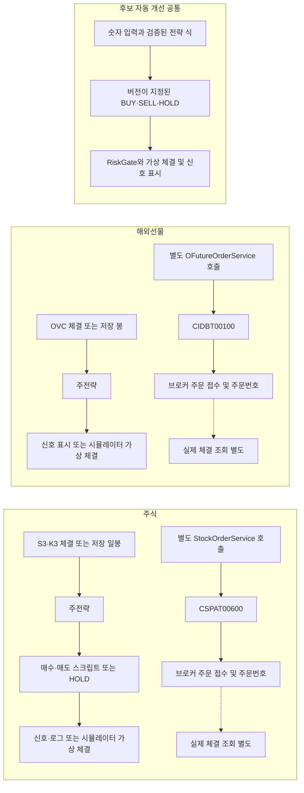

# DumbTrader 전략 후보 생성 및 모의 운용

## 주문 경로 확인



- 기본 로그인 화면은 Xing 모의투자 서버에 연결한다. 별도 주문 서비스의 응답은 접수 결과다. 후보 경로에는 주문 서비스 호출과 실제 체결 처리가 없다.
- 레거시 주식 전역 객체에는 종목, 체결 데이터, DB, 로그, 주식 데이터 서비스, 시뮬레이션 여부, 자본금, 컨텍스트가 있다. 레거시 해외선물 전역 객체에는 계약, 체결 데이터, DB, 로그, 시뮬레이션 시각, 자본금, 포지션과 컨텍스트가 있다. 두 객체 모두 주문 서비스를 직접 전달하지 않는다.
- 레거시 Roslyn 실행기는 .NET 참조를 가진 스크립트를 앱 프로세스에 로드하며 취소 토큰을 사용한다. 후보의 Roslyn 진단은 숫자 식에만 수행한다. 실행기는 허용된 구문을 호스트 연산으로 변환하고 주문·DB·파일·네트워크 객체를 전달하지 않는다.
- 후보의 주문 경계는 `PaperTradingService`의 시세 처리와 `RiskGate`다. 활성 포인터는 **실시간 표시용 신호 버전**을 지정한다. 가상 포지션과 가상 미체결을 확인하고, 별도의 증권사 계좌 포지션·미체결 조회를 사용하는 주문 활성화는 후속 단계로 남겨 둔다.

## 화면과 설정

1. 관심종목의 상세 화면에서 **Codex 전략 후보**를 연다. 해외선물은 일봉·1분봉·10분봉, 주식은 일봉을 지원한다.
2. 봉 주기와 시작일을 고른 뒤 **Codex 후보 생성**을 실행한다. 해외선물 수동 생성은 완료된 유효 봉 1개부터 가능하다. 150개 미만이면 후보 식과 컴파일 결과만 보이는 `Preview`로 저장한다. 정식 평가·페이퍼 운용·활성화에는 이전과 같이 150개가 필요하다. 국내주식과 예약 생성의 기준도 150개다. 평가에는 최근 유효 봉을 최대 5,000개 사용한다.
3. **실행 설정**에서 `CliPath`, `Model`, `WorkRoot`, `TimeoutSeconds`, 시장별 자본과 비용, 수량·손실·낙폭·표본 한도를 편집한다. 기본 `CliPath`는 Windows npm 설치 또는 PATH에서 실행 파일을 찾는다. 다른 설치는 `.exe`의 전체 경로를 입력한다. 인증은 실행기 밖에서 준비하며 Codex 로그인 상태를 사용한다. 해외선물의 장중 무수신 감시가 필요하면 `FuturesSessionHoursKorea`에 한국 시각 `Open`과 `Close`를 지정한다.
4. **현재 종목을 예약 대상으로 지정**하면 연결된 앱에서 설정된 로컬 시각 이후 그 종목의 후보를 하루 한 번 생성한다. 기본 자동 실행은 꺼져 있다. 저장된 종목과 평가 기간을 기준으로 동작하며 실행 중에는 같은 저장소에서 다른 생성 작업이 대기 또는 실패한다. 수동 생성 버튼으로 오류를 해결한 뒤 재시도할 수 있다.
5. 통과 후보의 코드·기준 식·성과·감사 기록을 검토하고 **모의 운용 시작**을 누른다. 모의 운용 구독은 전략 창을 닫아도 앱이 유지한다. 한 종목에는 모의 후보 한 건이 실행된다. 결과는 같은 실시간 봉에서 기준 버전과 비교한다.
6. 모의 운용 기간, 완료 거래 수, 낙폭, 순손익, 시세 신선도 및 FLAT 기준을 충족하면 **신호 버전 승인**을 선택한다. **신호 버전 활성화**가 활성 포인터를 교체한다. 이전 활성 버전이 있다면 전환 시에도 해당 버전의 가상 포지션과 미체결 신호를 확인한다. 활성 신호는 대시보드에 버전 ID와 함께 표시된다.
7. 지연 시세, 반복된 식 오류 또는 위험 한도 위반이 감지되면 후보를 중단하거나 활성 신호를 이전 버전으로 복구한다. `KillSwitch`는 새 작업과 활성 신호를 차단한다. 수동 **이전 버전 복구**도 감사 기록에 남는다.

기록은 `%LOCALAPPDATA%/DumbTrader/strategy-evolution`에 저장된다. SQLite가 후보 상태, 활성 포인터와 설정 변경 이력을 관리한다. 버전 디렉터리에는 후보 소스와 SHA-256, 고정 데이터·설정, 프롬프트, 생성 진단, 평가 기록의 근거 및 모의 체결 기록이 남는다. 활성 버전의 가상 포지션과 전략 상태는 마지막 완료 봉의 체크포인트에서 복원한다. 앱이 종료될 때 모의 후보 세션은 종료된다.

## 평가 규칙과 가정

- 학습 60%, 순차 검증 10%씩 두 구간, 최종 평가 20%로 나눈다. 검증·최종 데이터와 결과는 프롬프트에 포함하지 않는다. 앞선 검증을 통과해야 최종 구간을 평가하며 같은 종목·봉 주기의 이미 사용한 최종 구간과 겹치면 추가 평가를 보류한다.
- 후보와 기준에는 동일한 데이터와 비용을 적용한다. 활성 후보 버전이 없을 때 자동 개선은 내장 5·20 이동평균 교차식을 기준으로 삼는다. 레거시 수동 스크립트는 별도 시뮬레이션 화면에서 실행한다.
- 종가에서 계산한 신호는 다음 봉 시가에 적용한다. 해외선물 손익은 `가격 변화 ÷ 틱 크기 × 틱 가치 × 수량`을 기준으로 계산한다. 틱 수는 가장 가까운 틱으로 반올림한다. 개시증거금과 수량을 적용하고, 미청산 포지션은 마지막 가격으로 평가한다. 주식은 현금으로 매수하고, 매도 신호는 보유분을 닫는다.
- 비용 차감 전 손익과 비용 포함 손익, 낙폭, 관측 봉 수로 센 회복 기간, 봉별 자본 수익의 평균을 표본 표준편차로 나눈 비연율화 지표, 거래 수, 평균 및 최악의 거래 손익을 기록한다. 각 검증 구간에서 비용 차감 후 손익이 양수이고 기준 이상이며 낙폭·최소 거래 조건을 만족해야 한다. 보고서는 비용 2배에서의 민감도도 보여 준다.
- 시작 기본값은 해외선물 편도 수수료 2와 슬리피지 1틱, 주식 편도 수수료율 0.1%와 매도세율 0.3%, 최대 낙폭 10%, 검증 구간 3건, 모의 운용 24시간과 완료 거래 5건이다. 비용은 계좌·거래소별 값으로 조정할 예시다. 채택 판단 시에는 평가 당시 설정과 현재 위험 한도를 함께 사용한다.
- 봉 PK로 동일 종목·주기의 중복을 제어한다. 잘못된 시각·가격·거래량을 제외하고, 최신 저장 봉은 진행 중일 수 있어 제외한다. 누락 봉은 보간하지 않는다. 해외선물 계약 롤오버, 환전 비용, 유지증거금 청산, 호가·지연·부분 체결 모델은 포함하지 않는다.
- 주식 과거 데이터는 t8410 수정주가를 사용하며 현재 관심종목에 대한 결과이므로 종목 편향이 있다. 주식 모의 체결은 정규장 체결 틱을 사용한다. 과거 거래정지·상하한가에서의 주문 가능 여부, 기업행사와 실제 호가 대기열은 저장된 OHLCV만으로 재현할 수 없다. 외부 뉴스와 경제지표 입력도 별도 연동이 필요하다.

## 검증 실행

Visual Studio 2022의 .NET Framework MSBuild, .NET 9 SDK와 x86 XA COM 등록이 필요하다. 검증 프로그램은 임시 SQLite와 합성 시세 및 대체 생성기를 사용한다.

```powershell
msbuild tests/StrategyEvolution/StrategyEvolution.Tests.csproj -restore -v:minimal
& "${env:ProgramFiles(x86)}\dotnet\dotnet.exe" tests/StrategyEvolution/bin/Debug/net9.0-windows/StrategyEvolution.Tests.dll
```
